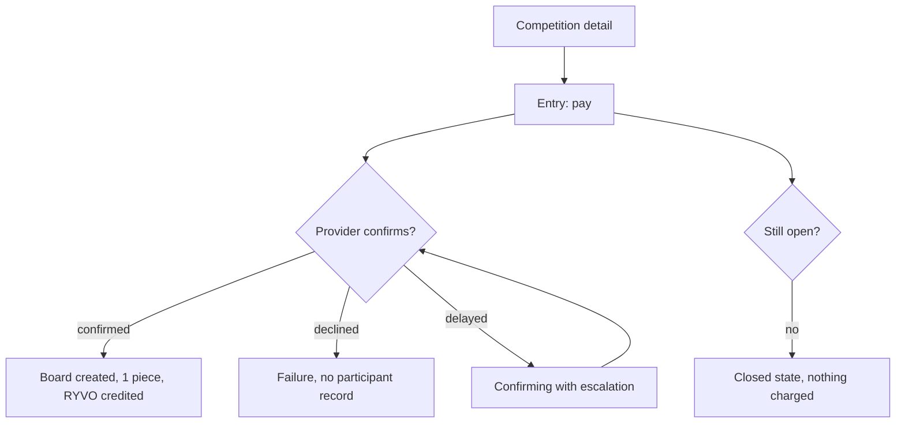

# Ryvo — UX Brief

Phase 2 output · v1 participant surface · 13 November 2026
Input: [`requirements.md`](./requirements.md) · Next: [`design-brief.md`](./design-brief.md)

## Problem and user

**Problem statement.** A set-completion collector needs a way to finish a set they have started, because assembling artwork piece by piece across scattered marketplaces means the last few pieces either never appear or appear at prices that make finishing irrational — so they abandon sets with real money already sunk.

**Primary user.** 22–40, already collects sets (physical cards, stickers, digital sets). Evening desktop sessions at 1280–1440, occasional phone checks. Marketplace-literate, not crypto-native. Wants to know exactly what's missing, whether the board is still winnable, and what the money does. Fears spending into a dead end and fears paying into rules they don't understand.

**Chosen concept.** *Completion Board, with an advisor line and one live race figure.* The board is the spine of the product; the gap panel speaks in plain arithmetic; the race survives only as **winner slots remaining and time remaining** — no standings, no competitor identities, no per-participant ranking.

## Concepts considered

### 1 · Completion Board — chosen as the spine

The product is a workbook holding the boards you're finishing; competitions are the doors you came through. **Optimises for** jobs 1 and 4, calm precision, and a natural home for the stall state. **Sacrifices** discovery and urgency, and a new participant meets an empty workbook. **Survived** because it is the only concept whose home screen is still right at day 100, and it matches the "loop + wallet" scope exactly.

### 2 · Live Race — rejected, one element kept

A season of races: clock, finish line, field of runners, you somewhere in it. **Optimises for** job 3, urgency, daily return, and genuine differentiation. **Rejected because** it places a countdown and a shrinking slot count at the centre of the product — three steps from the gambling interface we ruled out — and it needs other participants' positions, which requirements leave unresolved (open question 3). It also fails the day-100 test once races thin out. **Kept:** winner slots remaining, as a single figure.

### 3 · Advisor — rejected, one element kept

The product hands you one honest recommendation, including when the recommendation is to stop. **Optimises for** jobs 2, 3 and 5 and comprehension — the best trust story of the three. **Rejected because** it cannot render a 50-piece board, hides inventory behind a judgment, collapses with multiple boards, and needs recommendation logic a mock build cannot honour. A pure Advisor also patronises returning users. **Kept:** the advisory line in the board's gap panel — arithmetic stated plainly, decided by the participant.

### Also considered and discarded before comparison

- **Queue-first / season ticket.** Made registration sequencing the product's spine. Discarded: the queue is a constraint of the platform, not a job the participant has.
- **Marketplace-first / shopping list.** Board as shopping list, supply as the hero. Discarded: it optimises job 1 best of all, but it requires the marketplace deliberately excluded from v1.

## User journey map

| Stage | Goal | Actions | Thoughts and feelings | Pain points | Opportunities |
|---|---|---|---|---|---|
| Arrival | Understand if this is for me | Lands on a shared competition or the queue | "Is this a raffle?" — suspicion first | Nothing explains the model in one line | Show a partial board; it is the fastest proof this isn't a lottery |
| Evaluation | Decide to pay ₦500 | Reads fee, winners, capacity, rules | "What do I actually get for ₦500?" | Rules arrive as a wall or not at all | Fee and received value in one arithmetic block, above the rules |
| Entry | Pay without doubt | Pays, waits, receives receipt | Anxiety in the gap between paying and seeing | Silence after payment reads as theft | Explicit confirming state naming what will arrive and when |
| First build | See what I own | Opens the board, reads the gap | "9 to go? That's a lot." — but it's a puzzle | Twelve ghosted slots looks insurmountable | Progress framing plus the honest cheapest route defuses the wall |
| Grind | Close gaps | Checks supply, buys, waits, maybe spends a Universal Piece | "Nobody's selling. Am I stuck?" | The dead end is invisible until too late | Supply reality in the gap panel; a designed stall state |
| Resolution | Understand the outcome | Reads result, allocation or refund | Relief or disappointment, plus "did I get my money back?" | Ambiguity at closure destroys trust permanently | One sentence per outcome, ₦ figure attached |
| Habit | Play the next one | Returns, sees the new live competition | "The next one opened." | Nothing pulls them back | Queue position and one clear next competition |

## User flows

### J1 — Close the gap

1. Open **My Boards**; boards sorted by what needs attention.
2. Open a board: progress, then the grid, then the advisor line.
3. Open a missing slot: supply count, listings, cheapest listed price.
4. Choose a route — buy a listing, activate a Universal Piece, or notify-me.
5. Confirm; the board updates and the slot fills.
6. Repeat from step 3 until complete.

*Stalled variant:* the slot shows 0 listed → the advisor line states the cheapest complete route is unavailable → routes offered are Universal Piece and notify-me → the participant waits with a date, not a void.
*Failure variant:* the listing sells between viewing and confirming → the slot returns to unclaimed with "no longer available" and the next-cheapest listing.

### J2 — Enter a competition

1. **Competition queue**; exactly one carries the live join action.
2. Open **Competition detail**; read what you receive, the fee, winners, rules.
3. **Entry**: pay the fee.
4. **Confirming**: receipt shown, nothing granted yet.
5. Provider confirms → board created with one piece, RYVO credited.
6. Land on the board.

*Declined:* plain failure, no participant record, retry is safe.
*Delayed:* confirming persists with an escalation path after the stated window.
*Duplicate webhook:* exactly one board, one piece, one credit.
*Filled while paying:* rejected with the closed state, nothing charged.



### J3 — Check whether I can still win

1. Board shows winners remaining, time remaining, pieces missing, cheapest route cost.
2. Participant does the arithmetic and decides.
3. No standings, no competitor identities, no "you're falling behind" copy.

### J4 — Understand what I'm worth

1. **Wallet**: RYVO balance with the not-cash statement.
2. Cash held in separate pending / available / held groups.
3. Pieces owned, Universal Pieces remaining.
4. Open a ledger entry; reference traces to the board it affected.

### J5 — Recover from a dead board

1. Board enters grace period; advisor states plainly the board will not complete.
2. Two exits: spend a Universal Piece for one gap, or let the registration piece convert at close.
3. Both rules are stated before the moment they apply.
4. At close: conversion notice or refund notice, with the ₦ figure.

## Information architecture

**Global navigation:** My Boards · Competitions · Wallet, plus notifications and account as utilities. Board is global because it is the spine; competition detail is contextual — reached from the queue or from a board, never a habitual destination.

```
My Boards (home)
├── Board                      ← hero screen
│   ├── Missing slot detail     (supply, routes)
│   ├── Universal Piece activation
│   └── Result / closure state
Competitions
├── Competition detail
│   └── Entry → Confirming → Receipt
Wallet
├── Ledger entry detail
└── Verification (withdrawal only, dormant in v1)
Notifications · Account
```

## Screen inventory

| # | Screen | Purpose · job | Primary action | Content priority | States | Key? |
|---|---|---|---|---|---|---|
| S1 | **My Boards** | See every board and its gap · J1, J3 | Open the board needing attention | Progress per board → missing pieces → winners and time left → queue strip | First run (no boards) · one board · many boards · all closed · loading · error | Key |
| S2 | **Competition queue** | Ordered lane, one live join | Join the open competition | Live competition with fee and winners → ordered upcoming → active and closed | One open · none open · closing today · loading | Supporting |
| S3 | **Competition detail** | Decide whether to pay | Enter for ₦X | Artwork → what you receive → fee and credit arithmetic → winners and capacity → closure, refund, conversion rules → timeline | Open · nearly full · full · closed · cancelled · refund pending | Key |
| S4 | **Entry** | Pay without doubt | Pay ₦X | Amount → credit received → what happens next → payment method → KYC note | Idle · processing · declined · method unavailable | Key |
| S5 | **Confirming / receipt** | Hold the trust gap open | View receipt | Paid → what will arrive → expected timing → reference | Confirming · delayed with escalation · confirmed · failed | Key |
| S6 | **Board** | The gap, supply and honest next move | Act on the recommended route | Progress and gap → full grid → advisor line (missing · cheapest complete route · listed now) → winners and time → routes → acquisition history | In progress · all-but-one · complete · stalled · grace period · closed-converted · closed-refunded · 50-piece density · loading | **Hero** |
| S7 | **Missing slot** | Choose a route for one gap | Choose buy, activate or notify | Supply count → listings and prices → activation availability → notify-me | Listings exist · zero supply · activation available · activation already used · listing sold mid-flow | Supporting |
| S8 | **Activate Universal Piece** | One-way action, fully explained | Activate | Rule (one per competition) → that Ryvo selects → what you'd receive → confirm | Available · ineligible · confirming · activated with result · error rolled back | Key |
| S9 | **Result / closure** | Explain what happened to money and board | View allocation, or return to boards | Outcome → ₦ allocation or refund → when → why it closed now | Winner · completed after winner count met · no-winner refund · cancelled | Key |
| S10 | **Wallet** | Every balance, kept separate | Open a ledger entry | RYVO plus not-cash statement → cash pending/available/held → pieces → Universal Pieces → history | New account · holdings · pending holds · empty ledger · error | Key |
| S11 | **Ledger entry** | Trace any movement | Read-only | Amount and direction → reason → date → reference → affected board | Settled · pending · reversed | Supporting |
| S12 | **Notifications** | In-app state changes | Open the affected screen | Closing soon → closed → converted → credited | Empty · unread · stale target | Supporting |

**Cross-cutting states that must be designed, not fallen back to:** first-run empty board, stalled board with zero supply, completed board, competition full, competition closed mid-flow, payment declined, payment delayed, duplicate webhook suppressed, 50-piece density, empty ledger.

## Hero screen

**S6 · Board.** Carries three of five core jobs, holds the only stall state, must survive 10, 25 and 50 pieces, and forces the visual language to be decided honestly: a grid of authored slots, one live competition figure, one advisory sentence, one accent doing all the shouting.

## UX principles

1. **The gap is the product.** Every screen answers "what's missing" before anything else.
2. **Value appears only after the server confirms it.** No optimistic credits, no provisional pieces.
3. **Arithmetic, not adjectives.** "9 of 12 · 3 missing · ₦2,400 · 0 listed" instead of "almost there!"
4. **One shouting element per screen.** Competition state is the only thing allowed to be loud.
5. **Honest dead ends.** When a board can't be finished, say so and show the way out.

**Voice and tone.** Second person, numbers before nouns, state rather than feeling. No exclamation marks, no "hurry", no urgency verbs. A refusal names the rule and the remedy in the same sentence.

## Traceability

Every must-have in `requirements.md` maps to a screen, with three flagged exceptions.

| Must-have | Screens |
|---|---|
| Ordered queue with one live join | S2, S1 (queue strip) |
| Competition detail with rules | S3 |
| Explicit confirming state | S4, S5 |
| Board as physical set grid, 10–50 | S6 |
| Supply reality for missing pieces | S6, S7 |
| Wallet with split balances and history | S10, S11 |
| Universal Piece activation, one per competition | S8, S7 |
| Winner proximity and completion | S6, S9 |
| Closed / cancelled / refunded reachable from any live surface | S3, S6, S9 (shared closed state) |

**Flagged gaps — requirements nothing serves yet:**

1. **Referral rewards are invisible.** Attribution exists server-side, but no screen shows why a participant did or didn't earn one. Open question 6; v1 consciously omits the UI, which will read as a missing feature to any referrer.
2. **The capacity clock has no screen.** If a competition sits below capacity, the 30+30 clock never starts and no admin UI exists to set a deadline. Open question 2 blocks the competition's own lifecycle from resolving.
3. **The supply panel promises a marketplace that v1 doesn't build.** S6 and S7 display listing counts and prices that can only be real once listings exist. Open question 5.

## Open questions carried forward

As listed in `requirements.md`: the capacity clock, winner-position disclosure, participant-facing success metric, free claims, marketplace timing, and referral visibility.
